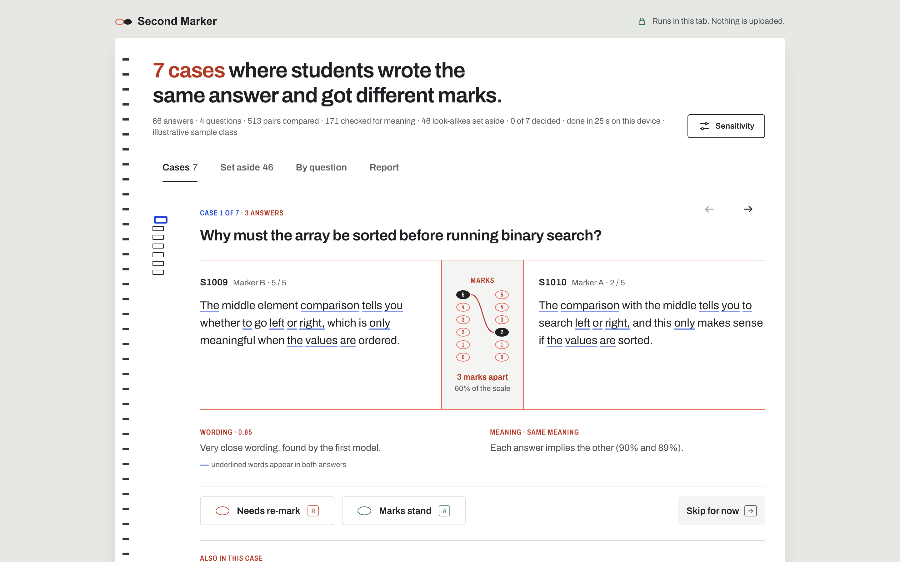

# Second Marker

**Same answer. Different mark.** Second Marker finds the students who wrote the same answer to a question and got different marks, shows each pair side by side with the evidence, and lets a person decide every case. Two small language models run inside the browser tab, so student work never leaves the computer.



## Why

Marking drifts. Fatigue, the order scripts are read in, and several markers on one module all mean that two students can write the same thing and get different marks. Universities catch some of this with moderation and second marking, by hand, on a small sample. Second Marker reads every answer and brings the moderator the pairs that disagree, with the evidence, so the sample is the right one.

It is a review aid, not a marker:

- it never changes a mark; every flag is a question for a person, answered with "Needs re-mark" or "Marks stand" and an optional reason;
- it explains each flag in plain words (how close the wording is, and whether each answer implies the other);
- it runs on the moderator's own machine: answers are read in the tab, and the page lists every network request it makes;
- the report uses anonymous codes (S-01, S-02, ...) instead of student ids; the code key is a separate, explicit download.

## How it works

1. **Load.** Drop a CSV (one row per answer: question, student id, answer, mark, and optionally max mark and marker). Columns are matched from the header and can be changed. Comma, semicolon and tab files are read.
2. **Wording.** Every answer is turned into a sentence embedding with `all-MiniLM-L6-v2`. Within each question, every pair of answers is compared (cosine similarity). Pairs that are worded alike (similarity at least 0.55) and whose marks differ by at least 30% of the scale become candidates.
3. **Meaning.** Each candidate pair goes through a natural-language-inference model, `deberta-base-long-nli`, in both directions: does answer A imply answer B, and does B imply A?
   - both directions imply: **same meaning**, flagged;
   - only the lower-marked answer implies the higher one: it says at least as much, **flagged**;
   - only the higher-marked answer implies the lower one: it says more, so the gap may be fair, **not flagged**;
   - either direction contradicts: **look-alike with the opposite meaning** (for example "a stack is LIFO" and "a stack is FIFO"), **not flagged**, listed under "Set aside" with the reason;
   - neither implies the other: not flagged.
   The reverse direction is skipped when the first already found a contradiction, because the verdict cannot change.
4. **Cases.** Flagged pairs that share an answer are grouped into one case and ranked by mark gap, wording similarity and the confidence of the meaning check.
5. **Review.** Each case shows the two answers on either side of a rail with both marks on the mark scale; words the answers share are underlined. Keyboard: `R` needs re-mark, `A` marks stand, arrow keys move between cases. A "Sensitivity" panel re-judges every case live as you move the similarity and mark-gap sliders (model results are cached, so this is quick).
6. **Report.** Per-question summary, a printable moderation report with anonymous codes, and a CSV export. Decisions are kept in this browser only (local storage), stored per answer pair so they survive a change of sensitivity.

Both models run in a Web Worker through Transformers.js and ONNX Runtime Web (WebAssembly). The site sets cross-origin isolation so the runtime can use several CPU threads; on static hosts that cannot send headers (GitHub Pages) a small service worker (`public/sw.js`) adds them, and also keeps a copy of the app's own files so it opens offline after one visit. Embeddings are cached in IndexedDB under a SHA-256 of the answer, so no answer text is stored by the cache.

## AI models the app runs

| Role | Model (as loaded) | Source model | Licence | Download (quantised, int8) |
|---|---|---|---|---|
| Wording similarity (sentence embeddings) | [`Xenova/all-MiniLM-L6-v2`](https://huggingface.co/Xenova/all-MiniLM-L6-v2) | [`sentence-transformers/all-MiniLM-L6-v2`](https://huggingface.co/sentence-transformers/all-MiniLM-L6-v2) | Apache-2.0 | 23 MB + 0.7 MB tokenizer |
| Meaning check (natural-language inference) | [`onnx-community/deberta-base-long-nli`](https://huggingface.co/onnx-community/deberta-base-long-nli) | [`tasksource/deberta-base-long-nli`](https://huggingface.co/tasksource/deberta-base-long-nli) (from `microsoft/deberta-v3-base`) | Apache-2.0 | 223 MB + 8.7 MB tokenizer |

The models are downloaded from the Hugging Face hub on first use (about 255 MB in total) and cached by the browser; after that the app works offline. No API key, account or server is involved.

Why two models: wording similarity alone cannot tell "a stack is LIFO" from "a stack is FIFO" (similarity 0.99). The meaning check is what turns similar wording into evidence. On the labelled sets below, wording similarity alone flags 3 to 5 times as many pairs, most of them wrong.

How the NLI model was chosen: nine NLI models that run in the browser were compared on the labelled sets (`scripts/compare-nli.ts`): `nli-deberta-v3-xsmall`, `EttinX-nli-xs`, `EttinX-nli-xxs`, `nli-deberta-v3-small`, `deberta-small-long-nli`, `ModernBERT-base-nli`, then `deberta-v3-base-tasksource-nli`, `DeBERTa-v3-base-mnli-fever-anli` and `deberta-base-long-nli`. The small models called technical paraphrases ("LIFO" versus "the newest item is removed first") contradictions. `ModernBERT-base-nli` was used first, but in the browser it ranked a role-swap look-alike (stack and queue definitions reversed) as the top case; `deberta-base-long-nli` rejected all look-alikes on the sample, at the cost of a larger download.

## Measured results

The sample class and the evaluation sets were written for this project. Each has **planted mis-marks** (an answer given a mark that disagrees with an equivalent answer to the same question) and **look-alike traps** (pairs that share most words but say opposite things). None of it is real student work.

- *Recall*: planted mis-marks that end up in a flagged case.
- *Precision*: flagged pairs that involve a planted mis-mark.
- *Traps rejected*: look-alike pairs that are not flagged.

| Set | What it is | Recall | Precision | Traps rejected | Wording alone (precision) |
|---|---|---|---|---|---|
| Sample class (66 answers, 4 questions) | Thresholds were chosen on this set | 9/10 | 15/15 | 8/8 | 63/173 |
| Held-out 1 (36 answers, 3 questions) | Not used for thresholds; its scores were visible while comparing NLI models | 6/6 | 10/11 | 6/6 | 20/53 |
| Held-out 2 (36 answers, 3 questions) | Written after every model and threshold choice; run once | 5/6 | 7/8 | 6/6 | 12/31 |

These figures come from `npm run eval`, which runs the same pipeline in Node (ONNX Runtime for Node). In the browser (WebAssembly, several threads) the quantised models give slightly different scores, so a few pairs near a threshold go the other way. The browser figures, from `npm run e2e`, which loads each file through the app's file picker:

| Set | Recall | Precision | Traps rejected |
|---|---|---|---|
| Sample class | 8/10 | 16/18 | 7/8 |
| Held-out 1 | 6/6 | 11/12 | 6/6 |
| Held-out 2 | 5/6 | 7/9 | 6/6 |

Read these with care: the sets are small, written by the same author as the pipeline, and in English. They show the method works on clear cases; they are not a benchmark.

Speed, measured on the development machine (Apple Silicon laptop, Chromium): the sample class (66 answers, 513 pairs compared, about 170 meaning checks) takes about 10 to 14 seconds with cached models; the first run, including the 255 MB model download on a fast connection, took 25 to 29 seconds. Slower machines and connections will take longer.

## Run it

Requirements: Node.js 20.19+ or 22.12+, and a recent Chromium-based browser, Firefox or Safari.

```bash
npm install
npm run dev          # http://localhost:5173, then "Try the sample class"
```

Other commands:

```bash
npm test             # unit tests (CSV, column mapping, word comparison, verdicts, pipeline, report)
npm run eval         # runs both models in Node on the labelled sets and prints the table above
npm run build        # static site in dist/ (works from any sub-path)
npm run preview      # serves dist/ with the isolation headers
npm run e2e          # after npm run build; drives the built site in headless Chromium: 19 checks plus in-browser scores
```

`npm run eval` and `npm run e2e` download the models on first use (`eval` caches them in `.cache/models`). No environment variables or keys are needed.

### Your own marksheet

Export it as CSV with one row per answer. Column names can be anything; you match them on the second screen. Max mark is optional (the highest mark seen for a question is used instead). Marker is optional and is shown on each answer.

### Deploy

The build is a static folder. `.github/workflows/pages.yml` builds and publishes it to GitHub Pages on every push to `main` once Pages is set to "GitHub Actions" in the repository settings. Any static host works; the service worker supplies the headers that enable threads where the host does not.

## Limits

- **Short answers, in English.** Both models are English models with a limited input length; essays and other languages are out of scope.
- **Similar meaning is evidence, not a verdict.** The meaning check makes mistakes, in both directions; a person must read every case. Marks can differ for reasons the text does not show (handwriting, a diagram, a rubric point outside the answer).
- **Answers are compared only within the same question**, and only pairs whose marks differ by at least the chosen share of the scale.
- **Results can vary slightly between devices** because the quantised models run with different numeric kernels (see the two tables).
- **First run downloads about 255 MB** from the Hugging Face hub; on a slow connection that takes minutes. After that the app works offline.
- **Decisions are stored in this browser only.** Clearing site data removes them; export the report to keep them.
- The bundled data is illustrative and was written for this project. Larger public short-answer datasets exist (for example Mohler et al., 2011), but the original release states no licence, so it is not included.

## Project layout

```
src/core/        pipeline, CSV reader, column mapping, word comparison, report, evaluation (shared by app and Node)
src/worker.ts    runs both models in a Web Worker
src/main.ts      the interface
src/styles.css   the visual system (see DESIGN.md)
public/          sample class and service worker
eval/            held-out sets and the truth files for every set
scripts/         eval, model comparison, end-to-end test, demo video recorder and editor
tests/           unit tests
```

## Licence

MIT, see `LICENSE`. The sample class and evaluation sets are original to this project and under the same licence. The models keep their own licences (Apache-2.0, see the table above). The Archivo typeface is under the SIL Open Font License.
